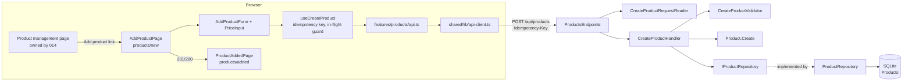

# Plan: Add a product

**Feature:** 001-add-product
**Spec:** [spec.md](spec.md)
**Status:** Draft
**Revision:** 1
**Spec revision:** 1
**Constitution:** 1.0.0
**Architecture:** 1.0.0
**Created:** 2026-10-17

## Summary

The Admin adds a product (name, SKU, price, description) through an add form in the React app. The form posts to `POST /api/products`. A thin Minimal API endpoint reads and checks the JSON structure, and an Application handler validates every field, including SKU uniqueness, and stores the product through EF Core in SQLite, with stock quantity 1, status Draft and the UTC date added. The schema is built **code first**: an EF Core model plus a migration applied at startup. SKU uniqueness (ignoring case and spaces) and "one Save action → one product" are enforced by two unique indexes: `NormalizedSku`, and `CreateRequestId`, filled from an `Idempotency-Key` header. Authentication, the protected layout and the product management page come from 014-admin-sign-in, which is built first. The sign-in prompt over the form comes from 017-session-expiry. Per the user's instruction, all work happens on `main`.

## Technical context

| Item | Choice |
|------|--------|
| Language / version | C# on .NET 10 (SDK 10.0.113); TypeScript ~6.0 |
| Main framework | ASP.NET Core Minimal APIs; React 19 + React Router 8, Vite 8 |
| Storage | SQLite through EF Core 10 (code first, migrations in `Infrastructure/Persistence/Migrations/`) |
| New libraries | `dotnet-ef` local tool, to generate migrations (R1). `@vitest/coverage-v8` and `dotnet-reportgenerator-globaltool`, to measure P3 coverage (R10). All three need `/sdd-architecture`. No new runtime library. |
| Test tooling | xUnit + NSubstitute (Domain, Application), `WebApplicationFactory<Program>` with a named shared-cache in-memory SQLite database (Api), Vitest + Testing Library (components), Playwright (e2e) |
| Target platform | Single-instance web app: Kestrel API + static React SPA, one SQLite file |
| Performance / scale constraints | NFR-002: 95% of adds confirmed < 1 s with 10,000 products. Both lookups (`NormalizedSku`, `CreateRequestId`) use unique indexes, so cost is O(log n). |

## Constitution check

| Principle | Result | Notes / justification |
|-----------|--------|-----------------------|
| P1. Single administrator | Pass | No user or role concepts. The endpoint relies on the single Admin session from 014. |
| P2. Test first (TDD) | Pass | Every task starts with a failing test (Test strategy). Each `feat` commit carries its test. The unique-constraint paths are tested directly against the repository, not left to timing. |
| P3. Coverage > 80% | Pass (once tooling is allowed) | New code is covered by unit, integration and component tests. The project cannot measure the threshold yet (R10). The plan asks for `@vitest/coverage-v8` and `dotnet-reportgenerator-globaltool` so the test command fails below 80%. |
| P4. Password hashing | Pass | No passwords handled in this feature. |
| P5. Authentication by default | Pass | The product route group calls `.RequireAuthorization()`, and 014 provides the scheme and the fallback policy. Integration tests use 014's real session handling to check for 401 without a session and with a forged one, and that nothing is stored (NFR-003). The frontend routes sit inside 014's protected layout. |
| P6. Input validation at the boundary | Pass | Api reader: body parsing, allowed field names, JSON types, Idempotency-Key. Application validator: every rule. All access goes through the EF Core LINQ/ORM; no raw SQL. Tests cover each rejected input. |
| P7. No secrets in code or logs | Pass | The connection string comes from user-secrets or an environment variable, never from `appsettings*.json` (R8). ProblemDetails replies hold only fixed field messages, with no exception text, type names or IDs. A test checks malformed bodies for no stack traces in Development and Production (NFR-006). Request bodies are not logged. |
| P8. Simplicity first | Pass | No mediator, mapper or validation library. Plain handler and validator classes, the BCL `TimeProvider` instead of a new `IClock`, and an optional field map on the existing `Error` instead of a new error type. The idempotency key is a column, not a new table. Each addition traces to an FR (mapping table). |
| P9. Clean build, visible errors | Pass | Warnings as errors already on (`Directory.Build.props`); oxlint and `tsc -b` must be clean. There are two `catch` blocks. The reader catches only `JsonException` and turns it into a 400. The repository catches only a UNIQUE-constraint `DbUpdateException` (extended code 2067), and rethrows when neither key matches. Anything else reaches `UseExceptionHandler`, which logs it. |

## Architecture check

Against [docs/architecture.md](../../docs/architecture.md) v1.0.0.

| Item | Value |
|------|-------|
| Backend layers touched | Domain, Application, Infrastructure, Api |
| Feature folders | `Domain/Products/`, `Application/Products/` (+ `CreateProduct/`), `Infrastructure/Persistence/` (+ `Configurations/`, `Repositories/`, `Migrations/`), `Api/Endpoints/ProductsEndpoints.cs` (+ `Endpoints/Products/` for the request reader), `Api/Contracts/Products/` (response contract), frontend `features/products/` |
| Layer rules | Respected. Domain has no references (uses only `System.Globalization` and `System.Text`). Application uses only Domain and the BCL `TimeProvider`. Infrastructure implements `IProductRepository` and runs migrations through its own hosted service. Api only reads the body, calls one handler and maps the result, and touches Infrastructure only through `AddInfrastructure()`. The existing `ShopManagement.ArchitectureTests` stay green. |

| Package | Layer / scope | Status |
|---------|---------------|--------|
| `Microsoft.EntityFrameworkCore` | Infrastructure | allowed (already referenced) |
| `Microsoft.EntityFrameworkCore.Sqlite` | Infrastructure, Tests | allowed (already referenced). `Microsoft.Data.Sqlite` (`SqliteException`, `SqliteConnection`) comes with it; no new PackageReference. |
| `Microsoft.EntityFrameworkCore.Design` | Api | allowed (already referenced) |
| `Microsoft.Extensions.DependencyInjection.Abstractions` | Application, Infrastructure | allowed (already referenced) |
| `Microsoft.AspNetCore.OpenApi` | Api | allowed (already referenced) |
| `xunit`, `NSubstitute`, `Microsoft.AspNetCore.Mvc.Testing`, `coverlet.collector` | Tests | allowed (already referenced) |
| `react`, `react-router`, Vitest, Testing Library, `@playwright/test` | runtime / dev | allowed (already installed) |
| `dotnet-ef` | tool (local manifest `.config/dotnet-tools.json` at the repo root) | requires /sdd-architecture |
| `@vitest/coverage-v8` | npm dev | requires /sdd-architecture |
| `dotnet-reportgenerator-globaltool` | tool (same local manifest) | requires /sdd-architecture |

Dependencies requiring /sdd-architecture (before `/sdd-approve plan`):
- `/sdd-architecture "add dotnet-ef as a local .NET tool (tool, manifest .config/dotnet-tools.json at the repo root) — generate EF Core code-first migrations in Infrastructure/Persistence/Migrations"`
- `/sdd-architecture "add @vitest/coverage-v8 (npm dev) and dotnet-reportgenerator-globaltool (local tool, same manifest) — enforce constitution P3: frontend vitest coverage threshold 80% lines; backend merge Cobertura from all test projects and fail below 80% lines; update the CLAUDE.md test command"`

## Preconditions

- **014-admin-sign-in's plan is approved, and 013/014 are built.** 014 owns the product management page and its route (014 FR-018, FR-008), the protected layout, the authentication setup and its integration-test helpers. Before `/sdd-tasks`, re-check this plan's "owned by 014" items against 014's approved plan. If file names or routes differ, update this plan through a Draft revision.
- The two `/sdd-architecture` changes above are done.

## Design



**Backend**
- **`ProductsEndpoints`** (Api): `MapGroup("/api/products").RequireAuthorization()` and `MapPost("/")` with an `HttpRequest` parameter, so the framework does no body binding. It calls `CreateProductRequestReader.ReadAsync`, then `CreateProductHandler.HandleAsync`, and maps the result to 201 (new, no `Location` until 003 adds a GET), 200 (replay) or a 400 ValidationProblem through `ProblemMapping`.
- **`CreateProductRequestReader`** (Api, `Endpoints/Products/`) does structural checks only (R4):
  - The Content-Type must be JSON (else 415).
  - It parses the body with `JsonDocument.ParseAsync` (MaxDepth 8, duplicate properties disallowed) and catches only `JsonException`. Empty or malformed JSON gets 400 "The request body is not valid JSON."
  - The root must be an object. Property names are matched case-sensitively in camelCase.
  - An unexpected name gets `errors[<name>] = ["The field '<name>' is not allowed."]`, with the name cut to 100 characters and at most 20 such fields reported.
  - `name`, `sku` and `description` must be strings or null, and `price` must be a JSON integer or null. Anything else gets the field's normal message.
  - `Idempotency-Key` must parse as a `Guid` (else `errors["Idempotency-Key"]`).
- **`CreateProductValidator`** (Application) checks the format rules and returns every message (FR-012). Lengths are counted in text elements (R6), after trimming name and SKU (FR-008). Messages:
  - name: "Name is required." / "Name can have at most 200 characters."
  - sku: "SKU is required." / "SKU can have at most 50 characters."
  - price: "Price must be a whole number of dong from 0 to 1.000.000.000." (also for a missing price)
  - description: "Description can have at most 2000 characters."
- **`CreateProductHandler`** (Application), in this order (contracts/application.md):
  1. Replay check by `CreateRequestId`. A match is returned as stored, before any validation (R3).
  2. The validator, plus `SkuExistsAsync` when the SKU passed its format rules. A duplicate adds "SKU is already used by another product." to the **same** error map, so every invalid field comes back at once.
  3. `Product.Create(…, timeProvider.GetUtcNow().UtcDateTime, key)`, then `AddAsync`. A unique-index race ends in either the replay or the `sku` error.
- **`Product`** (Domain): factory with invariants. It sets `StockQuantity = 1`, `Status = Draft` and `NormalizedSku`.
- **`Error`** (Domain/Common): gains an optional `FieldErrors` map. It stays sealed, and the existing `ResultTests` still pass.
- **`ProductRepository`** (Infrastructure): EF Core queries on the indexed columns. `AddAsync` catches only `DbUpdateException` whose inner `SqliteException` has `SqliteExtendedErrorCode == 2067` (UNIQUE). It detaches the entity, then checks whether the key is stored (→ `DuplicateCreateRequest`) or the normalized SKU is (→ `DuplicateSku`). If neither, it rethrows.
- **`AppDbContext`** + **`ProductConfiguration`** (with the UTC `DateTime` converter) + migration `AddProducts` (data-model.md). **`DatabaseMigrationHostedService`**, registered by `AddInfrastructure()`, applies migrations before Kestrel starts listening, so `Program.cs` only adds `MapProductsEndpoints()`.

**Frontend**
- **Routes** (`app/router.tsx`): `products/new` → `AddProductPage` and `products/added` → `ProductAddedPage`, nested under the product management route and protected layout from 014. The paths shown assume 014 uses `/products`; re-check against 014's plan. All moves are client-side navigations that push history entries, so there are no reloads and Back works (NFR-004).
- **Product management page** (owned by 014): 001 adds only an "Add product" link to `products/new` (FR-001).
- **`AddProductForm`**: four labelled fields (name, SKU, price, description textarea), Save and Cancel. It has no stock quantity or status field (FR-002). Field errors are shown under each field with `aria-invalid` and `aria-describedby`, and entered values are kept on any failure (FR-012). Cancel navigates to the product management page and discards values without asking (FR-016).
- **`PriceInput`**: `inputMode="numeric"`, implementing FR-006a.
  - `onBeforeInput` lets only digits through, and `onChange` also strips any non-digit that arrives by drop, autofill, IME or undo.
  - The display is regrouped with dots, keeping the caret after the same digit.
  - On paste, `parsePastedPrice` checks the pasted text alone: `^\d+$` or `^\d{1,3}(\.\d{3})+$`. Its digits replace the current selection, or are inserted at the caret. Anything else, or a result over 15 digits, is rejected with "Paste a whole number of dong, for example 125.000." and leaves the value unchanged.
  - The server still rejects values above 1,000,000,000.
- **`useCreateProduct`**: creates the idempotency key once per mount with `crypto.randomUUID()` and keeps it for every retry of that form (R3). It ignores `save` while a request is in flight, and Save is also `disabled` (FR-014, BR-028). Failures:
  - 400 with known field keys → field errors.
  - 401 → `session-ended`: "Your session has ended. The product was not saved." The form stays mounted, and 017's prompt is triggered by the refused operation (FR-015).
  - Anything else (network `TypeError`, 5xx, 403, 404, 415, a 400 without known field keys) → `not-saved`: "The product was not saved. Check your connection and try again."
  - Values live only in React state, never in local or session storage (BR-049).
- **`ProductAddedPage`**: reads the saved product from the navigation state and shows name, SKU, `formatVnd(price)`, description (or "No description"), stock quantity 1 and status Draft (FR-013). It offers "Add another product" (→ `products/new`, a fresh form and key) and "Back to products".
  - React Router keeps the navigation state in `history.state`, so a reload shows the same confirmation again. Nothing is resubmitted, and the values shown are already stored.
  - Opening the address without state (typed or bookmarked) redirects to the product management page.
  - Back returns to `products/new`, which mounts empty and never resubmits.

## Requirement → design mapping

| Requirement | Responsible component | Notes |
|-------------|-----------------------|-------|
| FR-001 | "Add product" link on 014's product management page; router | Client-side link; no reload |
| FR-002 | `AddProductForm` | Exactly 4 fields |
| FR-003 | `CreateProductHandler` | Stores only when the error map is empty |
| FR-004 | `CreateProductValidator`, `ProductRules` | Text-element length after trim |
| FR-005 | `CreateProductValidator`, `SkuExistsAsync` (in the same error map), `Product.NormalizeSku`, unique index `IX_Products_NormalizedSku` | Deleted products stay in the table (007), so their SKUs stay reserved |
| FR-006 | `CreateProductRequestReader` (JSON integer), `CreateProductValidator` (range) | `long` in VND |
| FR-006a | `PriceInput`, `shared/lib/vnd.ts` | Digits only, grouping, paste rule |
| FR-007 | `CreateProductValidator`, `Product.Create` | Empty → null |
| FR-008 | `CreateProductValidator`, `Product.Create` | Trim before check and store |
| FR-009 | `CreateProductRequestReader`, `Product.Create` | Unknown fields rejected by name; stock = 1 |
| FR-010 | `Product.Create`, `ProductStatus.Draft` | |
| FR-011 | `Product.CreatedAtUtc`, `TimeProvider`, UTC converter | R7 |
| FR-012 | Handler merges validator + uniqueness errors; `AddProductForm` | Values kept |
| FR-013 | `ProductAddedPage`, `formatVnd` | "125.000 ₫" |
| FR-014 | `Idempotency-Key` + `IX_Products_CreateRequestId`, replay checked first, `useCreateProduct` in-flight guard | R3 |
| FR-015 | `useCreateProduct` failure kinds, `AddProductForm` stays mounted; prompt from 017 FR-008 | No browser storage |
| FR-016 | `AddProductForm` Cancel | |
| FR-017 | `ProductsEndpoints` `.RequireAuthorization()`; 014's scheme, fallback policy and protected layout | |
| FR-018 | Reader + validator run on every request; no client-only rule | |
| NFR-002 | Unique-index lookups; perf integration test with 10,000 rows; browser timing at verify | |
| NFR-003 | `.RequireAuthorization()` + 014's scheme; 401 integration tests, row count 0 | |
| NFR-004 | React Router client routes with pushed history entries | e2e checks Back |
| NFR-005 | Reader + validator; integration tests per invalid input | |
| NFR-006 | Reader's own JSON parsing, `ProblemMapping` with fixed messages, `UseExceptionHandler` + `AddProblemDetails` | Tested in Development and Production |
| SC-001 | Whole flow | Timed by hand at verify |
| SC-002 | `Product.Create` | Domain unit test |
| SC-003 | Validator + unique index | |
| SC-004 | FR-014 design | |

## File structure

```
src/backend/
├── src/ShopManagement.Domain/
│   ├── Common/Result.cs                                   (modify: optional FieldErrors on Error)
│   └── Products/Product.cs, ProductStatus.cs, ProductRules.cs   (new)
├── src/ShopManagement.Application/
│   ├── DependencyInjection.cs                             (modify: register validator + handler)
│   └── Products/
│       ├── IProductRepository.cs, AddProductOutcome.cs, ProductDto.cs, ProductErrors.cs   (new)
│       └── CreateProduct/CreateProductCommand.cs, CreateProductResult.cs,
│           CreateProductValidator.cs, CreateProductHandler.cs                     (new)
├── src/ShopManagement.Infrastructure/
│   ├── DependencyInjection.cs                             (modify: DbContext, repository, TimeProvider, hosted service)
│   └── Persistence/
│       ├── AppDbContext.cs, DesignTimeDbContextFactory.cs, DatabaseMigrationHostedService.cs   (new)
│       ├── Configurations/ProductConfiguration.cs        (new)
│       ├── Repositories/ProductRepository.cs             (new)
│       └── Migrations/<timestamp>_AddProducts.cs (+ .Designer.cs, AppDbContextModelSnapshot.cs)  (generated)
├── src/ShopManagement.Api/
│   ├── Program.cs                                         (modify: MapProductsEndpoints)
│   ├── ShopManagement.Api.csproj                          (modify: UserSecretsId, if 014 has not added it)
│   ├── Endpoints/ProductsEndpoints.cs, ProblemMapping.cs  (new)
│   ├── Endpoints/Products/CreateProductRequestReader.cs   (new)
│   └── Contracts/Products/ProductResponse.cs              (new)
└── tests/
    ├── ShopManagement.Domain.Tests/Common/ResultTests.cs  (modify: FieldErrors)
    ├── ShopManagement.Domain.Tests/Products/ProductTests.cs                    (new)
    ├── ShopManagement.Application.Tests/DependencyInjectionTests.cs           (modify if needed: new registrations)
    ├── ShopManagement.Application.Tests/Products/CreateProduct/
    │   CreateProductValidatorTests.cs, CreateProductHandlerTests.cs            (new)
    └── ShopManagement.Api.IntegrationTests/
        ├── <014's test factory and sign-in helper>        (modify, owned by 014: named shared-cache
        │                                                   in-memory SQLite, ConnectionStrings:Default)
        ├── HealthEndpointsTests.cs                        (modify: use the shared test factory)
        └── Products/CreateProductEndpointTests.cs, ProductRepositoryTests.cs,
            CreateProductPerformanceTests.cs               (new)
.config/dotnet-tools.json                                  (new, after /sdd-architecture: dotnet-ef, reportgenerator)
.gitignore                                                 (modify: *.db, *.db-shm, *.db-wal)
CLAUDE.md                                                  (modify, per /sdd-architecture: coverage step in "Run tests")

src/frontend/
├── src/app/router.tsx                                     (modify: products/new, products/added)
├── src/shared/lib/vnd.ts, __tests__/vnd.test.ts          (new)
├── src/features/products/
│   ├── types.ts, api.ts, hooks.ts                         (new)
│   ├── components/AddProductPage.tsx, AddProductForm.tsx, PriceInput.tsx,
│   │   ProductAddedPage.tsx                               (new)
│   ├── components/<014's product management page>        (modify, owned by 014: "Add product" link)
│   └── __tests__/AddProductForm.test.tsx, PriceInput.test.tsx, useCreateProduct.test.tsx,
│       ProductAddedPage.test.tsx                          (new)
├── vitest.config.ts                                       (modify, after /sdd-architecture: coverage thresholds)
└── tests/e2e/add-product.spec.ts                          (new)
```

## Supporting documents

- [research.md](research.md): decisions R1–R10
- [data-model.md](data-model.md): `Product` entity, indexes, migration
- [contracts/create-product.openapi.yaml](contracts/create-product.openapi.yaml): HTTP contract
- [contracts/application.md](contracts/application.md): layer and frontend signatures

## Test strategy

Test types used below:
- **unit**: xUnit for Domain/Application, or Vitest for pure functions.
- **component**: Vitest + Testing Library, with the API mocked.
- **integration**: `WebApplicationFactory` with a named shared-cache in-memory SQLite database (`Data Source=file:{guid}?mode=memory&cache=shared`, one sentinel connection kept open, each DbContext opens its own), so concurrent requests really race. Signed-in requests go through 014's sign-in helper.
- **e2e**: Playwright against the running app, signing in through 014.

| Acceptance scenario | Test type | Test description |
|---------------------|-----------|------------------|
| US1 #1 | component + e2e | Management page → "Add product" shows exactly 4 labelled fields, no stock/status field; e2e checks no full reload |
| US1 #2 | integration + component + e2e | POST Blue Mug → 201, stock 1, Draft, row stored; typing 125000 shows "125.000"; confirmation shows "125.000 ₫" and all values |
| US1 #3 | integration + component | Price 0, empty description → stored, description null; confirmation "0 ₫", "No description" |
| US1 #4 | component + integration | Double click → one `createProduct` call; two concurrent POSTs with the same key → 1 row, both replies show the same product |
| US1 #5 | component | Cancel → navigates to the management page, `createProduct` not called |
| US1 #6 | integration | Body with `stockQuantity: 50` / `status: "Active"` / unknown field → 400, `errors` keyed by and naming that field, 0 rows; 30 unknown fields → at most 20 reported |
| US1 #7 | integration + e2e | POST without a session → 401, 0 rows, no data in body; e2e: `products/new` without a session shows sign-in (014) |
| US2 #1 | unit + integration | Empty / spaces-only name → "Name is required.", 0 rows |
| US2 #2 | unit | 201 vs 200 characters; NFD Vietnamese letters count as 1 |
| US2 #3 | unit | SKU empty, 51 rejected, 50 accepted |
| US2 #4 | unit + integration | Existing "ABC-1", post "abc-1 " → 400 `errors.sku` "already used"; also Vietnamese case ("ế" vs "Ế") |
| US2 #5 | unit + integration | 1000000001 and missing price rejected; 1000000000 accepted |
| US2 #6 | unit | Description 2001 rejected, 2000 accepted |
| US2 #7 | unit + integration + component | Empty name + price -1 → both errors in one reply; **empty name + duplicate SKU → both errors in one reply**; form shows them and keeps values |
| US2 #8 | integration | Direct POSTs with each invalid value → same field messages as the form |
| US2 #9 | component + e2e | Typing "-", ",", "a" leaves the field unchanged; paste "125,5" / "12.50" / "-1" / 16 digits → price message, value unchanged; paste "125.000" → 125000; paste mid-value inserts at caret |
| US2 #10 | integration | `price: -1`, `1500.5`, `"abc"`, `1e30` → 400 `errors.price`, 0 rows |
| US3 #1 | component + e2e | fetch rejects (offline) → form kept, "not saved" message; e2e uses `context.setOffline(true)` |
| US3 #2 | component + e2e | Retry after reconnect → one product, confirmation shown, same key reused |
| US3 #3 | component (now) + e2e (once 017 exists) | 401 → form stays mounted with values and "session has ended … not saved". The prompt and sign-in-then-save flow is e2e once 017-session-expiry is built. |
| US3 #4 | component | No `localStorage`/`sessionStorage` writes during fill, failure or retry (spied) |
| US3 #5 | integration + component | POST stored → same key again (also with an edited or invalid body) → 200 with the stored product, 1 row, no SKU error; hook test: first call fails after the server stored it, the retry gets 200 and shows the confirmation |
| FR-011 | unit | Handler stores `CreatedAtUtc` equal to the mocked `TimeProvider` time; integration round trip returns `createdAt` with "Z" on 201 and on the 200 replay |
| Repository unique paths | integration (direct) | Resolve `IProductRepository` from the factory and `AddAsync` a product whose normalized SKU exists → `DuplicateSku`; whose key exists → `DuplicateCreateRequest` |
| Unclassified failures | component | 403, 404, 415, 500 and a 400 without field keys → "not saved" message, values kept |
| Edge: trim name/SKU | unit | Stored trimmed |
| Edge: concurrent same SKU, different keys | integration | Parallel POSTs → one 201, one 400 `errors.sku` (unique index path) |
| Edge: same name, different SKU | integration | Both stored |
| Edge: 1-million-character name | integration | 400 `errors.name`, no internal details |
| Edge: Vietnamese text unchanged | integration | Stored and returned byte-identical |
| Edge: Back / Cancel from a filled form | component + e2e | Values discarded without a prompt, nothing stored |
| Edge: Back from confirmation | component + e2e | Shows an empty form, no second POST |
| Edge: SKU of a deleted product | — | 001 cannot create deleted rows; covered by 007-delete-product once deletion exists (rows stay in the table, so the unique index applies) |
| NFR-002 | integration (perf, `[Trait("Category","Performance")]`, kept out of the fast suite) + e2e timing at verify | Seed 10,000 products; 95th percentile of 50 POSTs < 300 ms server-side. `/sdd-verify` times Save → confirmation in the browser with 10,000 seeded rows. |
| NFR-003 | integration | 401 for no session and for a forged or altered session cookie (014's scheme), 0 rows |
| NFR-004 | e2e | Navigate management → form → confirmation with no `load` event; Back returns to the previous view |
| NFR-005 / NFR-006 | integration | Empty body, malformed JSON, non-object body, duplicate property, wrong type, non-JSON Content-Type → 400/415 ProblemDetails without stack trace, exception text or type names, in both Development and Production environments |
| Architecture rules | existing ArchitectureTests | Stay green with the new types |

e2e scenarios (`/sdd-verify` → `e2e-tester`): US1 #1, #2, #7, US2 #9, US3 #1, #2, #3 (once 017 exists), Back/Cancel from a filled form, Back from confirmation, NFR-002 timing, NFR-004. They need 013 (Admin account) and 014 (sign-in) built.

## Risks and mitigations

- **001 depends on 013 and 014 being built first**: 014's spec is still Draft with no plan. → Precondition above. Release also waits for 015, as 014's spec requires.
- **Sign-in prompt over the form (US3 #3) belongs to 017** → 001 only guarantees the form stays mounted with its values on 401. The full scenario is checked when 017 is built. Recorded here so 017's plan picks it up.
- **Code-first tooling and coverage are not on the allowlist** → The two `/sdd-architecture` commands above must run before plan approval.
- **Work on `main` vs the code gate**: `.claude/hooks/sdd-guard-edit.js` allows product-code edits only on a `feat/NNN-slug` or `fix/NNN-slug` branch, and the spec header names `feat/001-add-product`. On `main`, `/sdd-build` will be blocked. → The user decides how to handle this before `/sdd-build`. Claude will not work around the hook.
- **Edited retry after a lost response** shows the stored values, not the edited ones (R3). → The confirmation always shows the saved values, as FR-013 requires. If the user wants a different behavior, it goes through `/sdd-amend spec`.
- **Caret jumps in the auto-grouped price field** → Caret position is restored by digit index, with component tests for typing and pasting mid-number.
- **Connection string not in committed config makes first run fail** → The startup error names `ConnectionStrings:Default`, and the implementation notes give the `dotnet user-secrets set` command.

## Implementation notes

1. Prerequisites: the preconditions above, then `dotnet new tool-manifest` at the repo root and `dotnet tool install dotnet-ef`.
2. Domain: `Error.FieldErrors` (with `ResultTests`), `ProductRules`, `ProductStatus`, `Product` with tests.
3. Application: validator tests → validator; handler tests (NSubstitute repository, `TimeProvider`; order: replay → merged errors → add) → handler; DI registration.
4. Infrastructure: `AppDbContext`, `ProductConfiguration`, `ProductRepository`, `DesignTimeDbContextFactory` (`Data Source=:memory:`), `DatabaseMigrationHostedService`, then generate the `AddProducts` migration. `AddInfrastructure` throws if `ConnectionStrings:Default` is missing.
5. Api: extend 014's test factory (shared-cache in-memory SQLite) and move `HealthEndpointsTests` onto it. Then endpoint and repository tests → reader, `ProblemMapping`, endpoint, `Program.cs`. Dev setup: `dotnet user-secrets set "ConnectionStrings:Default" "Data Source=shopmanagement.db" --project src/backend/src/ShopManagement.Api`.
6. Frontend: `vnd.ts` → `PriceInput` → `api.ts` / `useCreateProduct` → form, pages, routes, "Add product" link.
7. e2e spec. Coverage thresholds go into the test command.

## Revision history

| Rev | Date | Spec rev | Change |
|-----|------|----------|--------|
| 1 | 2026-10-17 | 1 | Initial version |
