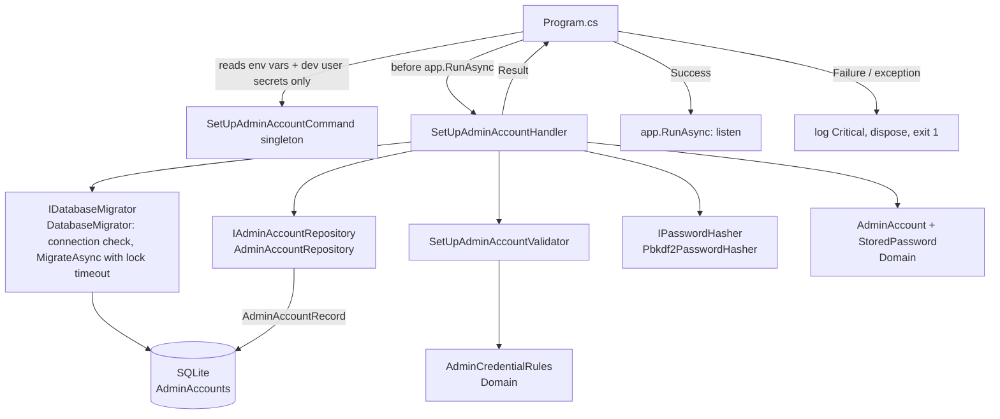

# Plan: Admin account setup

**Feature:** 013-admin-account-setup
**Spec:** [spec.md](spec.md)
**Status:** Approved
**Approved:** 2026-10-17
**Revision:** 1
**Spec revision:** 1
**Constitution:** 1.0.0
**Architecture:** 1.1.0
**Created:** 2026-10-17

## Summary

At every start, before Kestrel listens, `Program.cs` runs one Application use case, `SetUpAdminAccountHandler`. The handler:
1. applies the EF Core migrations to the SQLite database;
2. reads the Admin account;
3. if none exists, validates the setup values `AdminSetup:SignInName` and `AdminSetup:InitialPassword` (NFC-normalized, lengths in code points, no control characters);
4. hashes the password with PBKDF2-HMAC-SHA256 (16-byte salt, 600,000 iterations);
5. inserts the single row (`Id = 1`, enforced by a CHECK constraint).

The setup values are read only from environment variables, or from user secrets in Development, never from `appsettings*.json`.
- **Refusal:** every problem is logged by setting name and rule, never by value, and the process exits with code 1 before it listens.
- **Account already exists:** the setup values are ignored. The only effect is a warning while the initial password is still set.

This feature also creates the project's persistence base (`AppDbContext`, the first migration, the `dotnet-ef` tool manifest), the shared integration-test factory, and the backend coverage gate (P3).

## Technical context

| Item | Choice |
|------|--------|
| Language / version | C# on .NET 10 (SDK 10.0.113) |
| Main framework | ASP.NET Core (composition root only; no new endpoint) |
| Storage | SQLite through EF Core 10, code first. The first migration, `AddAdminAccounts`, goes in `Infrastructure/Persistence/Migrations/`. |
| New libraries | None. The local tools `dotnet-ef` 10.0.13 (generates the migration) and `dotnet-reportgenerator-globaltool` (coverage gate) go in `.config/dotnet-tools.json`; both are already allowed (architecture 1.1.0). Cryptography, Unicode and process APIs come from the BCL. |
| Test tooling | xUnit + NSubstitute for Domain and Application. In Api.IntegrationTests: `WebApplicationFactory<Program>` with a named shared-cache in-memory SQLite database and a capturing logger provider, plus process tests that run the built Api with `System.Diagnostics.Process` (R8). Coverage: `coverlet.collector` + ReportGenerator. |
| Target platform | Single-instance web app, one SQLite file |
| Performance / scale constraints | No speed NFR. One PBKDF2 hash (about 0.3–1 s) runs only at the start that creates the account. |

## Constitution check

| Principle | Result | Notes / justification |
|-----------|--------|-----------------------|
| P1. Single administrator | Pass | The fixed key `Id = 1` plus `CHECK ("Id" = 1)` makes the database refuse a second row, also under two simultaneous starts (R4). No endpoint, page or command creates an account. An integration test checks that no route registers, signs up, creates accounts, or manages users or roles (SC-003). |
| P2. Test first (TDD) | Pass | Every step in "Implementation notes" starts with a failing test, including the schema (constraint tests before `AppDbContext` and the migration) and the test factory (the moved health test fails first). |
| P3. Coverage > 80% | Pass | This feature adds the backend coverage gate (R9) to the "Run tests" command, so the backend threshold is enforced from now on. Generated migrations and the design-time factory are excluded. The refusal branch of `Program.cs` runs only in child processes, so it is not counted; the rest of the new code is covered in-process. The frontend is not changed. Its gate comes with 014, the first feature that changes the frontend. |
| P4. Password hashing | Pass | `Pbkdf2PasswordHasher` uses the static `Rfc2898DeriveBytes.Pbkdf2` with HMAC-SHA256, a 16-byte salt from `RandomNumberGenerator` per hash, and 600,000 iterations. The algorithm, salt and iteration count are stored with the hash (R3). Tests check the stored format, recompute the hash, and check that 10 hashes of the same password all differ (NFR-002). The constant-time comparison belongs to the password check in 014 (spec "Out of scope"); this feature never compares passwords. |
| P5. Authentication by default | Pass | No endpoint is added. The anonymous health check is 014's to close (spec "Out of scope"). |
| P6. Input validation at the boundary | Pass | The setup values and the connection string are external input. The validator, and the connection-string check in `DatabaseMigrator`, validate them before any business logic uses them, and a problem refuses the start. All database access goes through EF Core; there is no raw SQL in production code. |
| P7. No secrets in code or logs | Pass | The setup values come only from environment variables or user secrets (R2). The connection string comes only from configuration that is not committed (R6), and a test checks that no committed `appsettings*.json` holds `AdminSetup` or `ConnectionStrings`. Log messages are fixed texts with setting names and rules only (contracts/startup.md). EF Core command and update logging is turned off, so parameter facets never reach the log, and sensitive-data logging is never on (R7). `SetUpAdminAccountCommand` cannot print its values (R2). Test values are generated at runtime, so no test password is committed (R8). |
| P8. Simplicity first | Pass | No new package, project, mediator or options library. There is one handler, one validator and three small Application interfaces, each with an FR behind it (mapping table). `Error` gains one optional field instead of a new error type. `TimeProvider` (BCL) serves instead of a new `IClock`. The startup step sits in `Program.cs` instead of a hosted service (R1). `AdminAccountRecord` exists only because FR-014 needs damaged rows to stay readable (R3). |
| P9. Clean build, visible errors | Pass | Warnings as errors are already on. Four narrow `catch` blocks:<br>• The repository catches only the primary-key `DbUpdateException` (extended code 1555) and rethrows anything else.<br>• `DatabaseMigrator` catches only the `OperationCanceledException` of its own lock timeout.<br>• `AdminCredentialRules` catches only the `ArgumentException` of normalization.<br>• `Program.cs` catches any other exception of the startup step, logs it at `Critical` with the exception, and exits with code 1.<br>Each one returns a refusal or rethrows; none hides an error. |

## Architecture check

Against [docs/architecture.md](../../docs/architecture.md) v1.1.0.

| Item | Value |
|------|-------|
| Backend layers touched | Domain, Application, Infrastructure, Api (only `Program.cs`, `appsettings.json` and the `.csproj`) |
| Feature folders | `Domain/AdminAccounts/`, `Application/AdminAccounts/` (+ `SetUpAdminAccount/`), `Application/Common/`, `Infrastructure/Persistence/` (+ `Configurations/`, `Repositories/`, `Migrations/`), `Infrastructure/Security/` |
| Layer rules | Respected:<br>• Domain uses only the BCL (`System.Text`).<br>• Application uses Domain, the BCL `TimeProvider` and its own interfaces. It does no logging, because no logging package is allowed there (R7).<br>• Infrastructure implements `IDatabaseMigrator`, `IAdminAccountRepository` and `IPasswordHasher`.<br>• Api reads configuration, registers services, runs the handler and logs the result; it never calls `AppDbContext`.<br>The existing `ShopManagement.ArchitectureTests` stay green. |
| Conventions | `SetUpAdminAccountCommand` / `SetUpAdminAccountHandler` / `SetUpAdminAccountValidator` follow `Application/<Feature>/<Action>/`. There is no endpoint, so `Program.cs` takes the endpoint's role: bind, call one handler, map the result (to log lines and an exit code). |

| Package | Layer / scope | Status |
|---------|---------------|--------|
| `Microsoft.EntityFrameworkCore`, `Microsoft.EntityFrameworkCore.Sqlite` | Infrastructure | allowed (already referenced) |
| `Microsoft.EntityFrameworkCore.Design` | Api | allowed (already referenced) |
| `Microsoft.Extensions.DependencyInjection.Abstractions` | Application, Infrastructure | allowed (already referenced) |
| `Microsoft.EntityFrameworkCore.Sqlite` | Tests (Api.IntegrationTests) | allowed (already referenced) |
| `xunit`, `NSubstitute`, `Microsoft.AspNetCore.Mvc.Testing`, `coverlet.collector`, `NetArchTest.Rules` | Tests | allowed (already referenced) |
| `dotnet-ef` | tool (`.config/dotnet-tools.json`) | allowed (architecture 1.1.0) |
| `dotnet-reportgenerator-globaltool` | tool (same manifest) | allowed (architecture 1.1.0) |

Dependencies requiring /sdd-architecture: none.

## Interpretations to confirm

These are readings of the approved spec, not changes to it. If the user disagrees with one, it goes through `/sdd-amend spec` before tasks are made.

1. **SC-004 and the connection string.** SC-004 ("no step other than providing the 2 setup values and starting the system") counts the steps to set up the *Admin account*. The storage location (`ConnectionStrings:Default`) is a deployment setting that every feature needs. Constitution P7, which outranks the spec, forbids a committed default for it. A missing value gets its own clear refusal message (R6). The SC-004 process test provides the connection string as part of the deployment, and checks that the system needs no other step (no migration command, no setup command) and that it creates the database file itself.
2. **Text that cannot be normalized.** A setup value that contains an unpaired UTF-16 surrogate cannot be NFC-normalized (FR-015). It is refused as invalid under FR-004, with the rule "is not valid Unicode text" (R5). It can only come from a Windows environment variable.
3. **Hash length.** A stored hash that is not 32 bytes counts as "unreadable" under FR-014 (R3).

## Design



**Domain** (`Domain/AdminAccounts/`)
- `AdminCredentialRules` (R5) holds the rules that 014, 018 and 019 share:
  - NFC normalization;
  - trimming the sign-in name of all Unicode whitespace;
  - lengths in code points;
  - the control-character check.
- `StoredPassword` holds the algorithm, salt, iterations and hash, and `IsUsable` checks them against the P4 minimums.
- `AdminAccount` is the single account (`SingleId = 1`). `Create` is for new accounts and checks the rules; `Restore` is for stored rows and does not.
- `Common/Result.cs`: `Error` gets an optional `FieldErrors` map (setting → rule texts). Spec 001's draft plan planned the same change; 013 now makes it first.

**Application** (`Application/AdminAccounts/`, `Application/Common/`)
- `SetUpAdminAccountCommand` is a sealed class with the two values; its `ToString()` never shows them.
- `SetUpAdminAccountValidator` collects every problem of both settings in one pass (FR-005, edge case "both invalid").
- `SetUpAdminAccountHandler` runs migrate → read → decide, in the order given in [contracts/application.md](contracts/application.md). That contract also marks where 019 hooks in. The handler returns `Result<SetUpAdminAccountOutcome>` and never logs.
- Also here: `IPasswordHasher`, `IAdminAccountRepository`, `IDatabaseMigrator`, `AdminSetupErrors`, `StoredDataErrors`.
- `DependencyInjection.AddApplication()` registers the validator and the handler (scoped).

**Infrastructure**
- `Persistence/AppDbContext.cs`, `Persistence/AdminAccountRecord.cs`, and `Configurations/AdminAccountRecordConfiguration.cs`. The configuration sets NOT NULL columns and the CHECK constraint (data-model.md).
- `Migrations/<timestamp>_AddAdminAccounts.cs`.
- `Persistence/DesignTimeDbContextFactory.cs` lets `dotnet ef migrations add` run (`Data Source=:memory:`, no secret).
- `Persistence/DatabaseMigrator.cs` checks the connection string, then runs `Database.MigrateAsync()` with the lock timeout (R6).
- `Persistence/Repositories/AdminAccountRepository.cs`:
  - `ListAsync` reads without tracking and converts records with `AdminAccount.Restore`. A damaged password becomes an unusable `StoredPassword`; a missing name gives `UnreadableStoredData` (R3).
  - `AddAsync` handles the primary-key race (R4).
- `Security/Pbkdf2PasswordHasher.cs` (R3).
- `DependencyInjection.AddInfrastructure()` registers all of these, the DbContext (connection string read when the context is resolved) and `TimeProvider.System`.

**Api**
- `Program.cs`:
  - builds the setup-values configuration (R2) and registers `SetUpAdminAccountCommand`;
  - runs the startup step between `Build()` and `RunAsync()`, with the log messages of [contracts/startup.md](contracts/startup.md) (R1, R7);
  - its top-level statements now return `0` or `1`.
- `appsettings.json`: EF Core log levels (R7). No setup value and no connection string.
- `ShopManagement.Api.csproj`: a `UserSecretsId` from `dotnet user-secrets init`, for the development setup.

**Tooling**
- `.config/dotnet-tools.json` with `dotnet-ef` 10.0.13 and `dotnet-reportgenerator-globaltool`. The commands run from `src/backend`, so its `global.json` applies (R6).
- `CLAUDE.md` "Run tests": the bash command of R9.
- `.gitignore`: `*.db`, `*.db-shm`, `*.db-wal`, `src/backend/TestResults/`.

## Requirement → design mapping

| Requirement | Responsible component | Notes |
|-------------|-----------------------|-------|
| FR-001 | `AdminAccount.SingleId`, `CK_AdminAccounts_SingleRow` + primary key, `AdminAccountRepository.AddAsync` race handling | No endpoint or command creates accounts (SC-003 test) |
| FR-002 | `Program.cs` startup step before `app.RunAsync()`; handler step 5 | |
| FR-003 | `Program.cs` setup configuration: environment variables + user secrets (Development) only | R2 |
| FR-004 | Handler step 5: a validation failure means no hash and no insert; `Program.cs` → exit 1 | |
| FR-005 | `SetUpAdminAccountValidator` rule texts; `Program.cs` logs one line per problem | contracts/startup.md |
| FR-006 | `AdminCredentialRules.NormalizeSignInName` / `ValidateSignInName` | Letter case kept |
| FR-007 | `AdminCredentialRules.NormalizePassword` / `ValidatePassword` | Spaces kept; Cc refused |
| FR-008 | `Pbkdf2PasswordHasher`, `StoredPassword`; fixed log texts; command without `ToString` values | |
| FR-009 | Handler step 4: no write when an account exists | |
| FR-010 | Handler step 4: setup values not validated when an account exists | |
| FR-011 | `SetUpAdminAccountOutcome.InitialPasswordStillPresent` → `Program.cs` warning | An empty value gives no warning |
| FR-012 | One INSERT in one `SaveChangesAsync` (a SQLite transaction); hashing happens before the insert; the migration lock timeout | |
| FR-013 | `SetUpAdminAccountOutcome.CreatedAtUtc` (`TimeProvider`) → `Program.cs` information log | No name, password or hash |
| FR-014 | Handler steps 2–4 (`UnreadableStoredData`, `MultipleAdminAccounts`, `UnusableStoredPassword`); `AdminAccountRecord` keeps damaged rows readable; `Program.cs` exception catch | 019 hook A comes before the unusable-password refusal |
| FR-015 | `AdminCredentialRules` (NFC, `EnumerateRunes`) | Shared with 014, 018, 019 |
| FR-016 | `DatabaseMigrator.MigrateAsync` as handler step 1 | Creates the file if missing |
| FR-017 | `Program.cs`: on refusal, log, `DisposeAsync` (flush), `return 1`, so `RunAsync` is never reached. The lock timeout prevents a hang. | |
| NFR-001 | `Pbkdf2PasswordHasher`, `StoredPassword` columns | |
| NFR-002 | A fresh random salt per `Hash` call | |
| NFR-003 | Fixed log texts; EF Core log levels; no `AdminSetup` in committed config; test values generated at runtime | |
| SC-001 | NFR-003 tests; the stored row searched for the readable password; no literal test password committed | |
| SC-002 | US2 tests | |
| SC-003 | No endpoint added; route test | |
| SC-004 | Migrations at start + setup values only | Interpretation 1 |

## File structure

```
src/backend/
├── src/ShopManagement.Domain/
│   ├── Common/Result.cs                                         (modify: Error.FieldErrors)
│   └── AdminAccounts/AdminAccount.cs, StoredPassword.cs,
│       AdminCredentialRules.cs, CredentialRuleViolation.cs     (new)
├── src/ShopManagement.Application/
│   ├── DependencyInjection.cs                                   (modify: validator + handler)
│   ├── Common/IDatabaseMigrator.cs, StoredDataErrors.cs         (new)
│   └── AdminAccounts/
│       ├── IPasswordHasher.cs, IAdminAccountRepository.cs,
│       │   AddAdminAccountOutcome.cs                            (new)
│       └── SetUpAdminAccount/SetUpAdminAccountCommand.cs, SetUpAdminAccountHandler.cs,
│           SetUpAdminAccountValidator.cs, SetUpAdminAccountOutcome.cs,
│           SetUpAdminAccountStatus.cs, AdminSetupErrors.cs     (new)
├── src/ShopManagement.Infrastructure/
│   ├── DependencyInjection.cs                                   (modify: DbContext, services, TimeProvider)
│   ├── Persistence/AppDbContext.cs, AdminAccountRecord.cs,
│   │   DesignTimeDbContextFactory.cs, DatabaseMigrator.cs       (new)
│   ├── Persistence/Configurations/AdminAccountRecordConfiguration.cs (new)
│   ├── Persistence/Repositories/AdminAccountRepository.cs      (new)
│   ├── Persistence/Migrations/<timestamp>_AddAdminAccounts.cs (+ .Designer.cs,
│   │   AppDbContextModelSnapshot.cs)                            (generated)
│   └── Security/Pbkdf2PasswordHasher.cs                         (new)
├── src/ShopManagement.Api/
│   ├── Program.cs                                               (modify: setup values, startup step, exit code)
│   ├── appsettings.json                                         (modify: EF Core log levels)
│   └── ShopManagement.Api.csproj                                (modify: UserSecretsId)
└── tests/
    ├── ShopManagement.Domain.Tests/Common/ResultTests.cs        (modify: FieldErrors)
    ├── ShopManagement.Domain.Tests/AdminAccounts/AdminCredentialRulesTests.cs,
    │   StoredPasswordTests.cs, AdminAccountTests.cs             (new)
    ├── ShopManagement.Application.Tests/DependencyInjectionTests.cs  (modify: registers substitutes for the
    │                                                              Infrastructure interfaces and TimeProvider,
    │                                                              then resolves the handler)
    ├── ShopManagement.Application.Tests/TestSupport/FakeTimeProvider.cs  (new, hand-written)
    ├── ShopManagement.Application.Tests/AdminAccounts/SetUpAdminAccount/
    │   SetUpAdminAccountCommandTests.cs, SetUpAdminAccountValidatorTests.cs,
    │   SetUpAdminAccountHandlerTests.cs                         (new)
    └── ShopManagement.Api.IntegrationTests/
        ├── TestSupport/ShopApiFactory.cs, SqliteTestDatabase.cs (fixture owning the sentinel connection),
        │   CapturingLoggerProvider.cs, ApiProcess.cs, RepositoryRoot.cs, TestSecrets.cs  (new)
        ├── HealthEndpointsTests.cs                              (modify: use ShopApiFactory)
        └── AdminAccounts/AdminAccountSetupTests.cs,
            AdminAccountSetupProcessTests.cs,
            AdminAccountRepositoryTests.cs,
            AdminAccountSchemaTests.cs,
            DatabaseMigratorTests.cs,
            Pbkdf2PasswordHasherTests.cs,
            DeliveredConfigurationTests.cs,
            NoAccountCreationRoutesTests.cs                      (new)
.config/dotnet-tools.json                                        (new: dotnet-ef 10.0.13, dotnet-reportgenerator-globaltool)
.gitignore                                                       (modify: *.db*, src/backend/TestResults/)
CLAUDE.md                                                        (modify: backend coverage step in "Run tests")
```

## Supporting documents

- [research.md](research.md): decisions R1–R10
- [data-model.md](data-model.md): `AdminAccount`, `StoredPassword`, the rules, `AdminAccountRecord`, the `AdminAccounts` table
- [contracts/application.md](contracts/application.md): layer signatures, the handler order and the 019 hooks
- [contracts/startup.md](contracts/startup.md): settings, exit codes and log messages for the system operator

## Test strategy

Test types:
- **unit**: xUnit. Domain rules, and the Application command, validator and handler, with NSubstitute fakes and a hand-written `FakeTimeProvider`.
- **integration**: `ShopApiFactory` (`WebApplicationFactory<Program>`):
  - The database is a shared-cache in-memory SQLite database whose sentinel connection is owned by the `SqliteTestDatabase` fixture.
  - The factory replaces `SetUpAdminAccountCommand` with valid values through `ConfigureTestServices`, and adds a `CapturingLoggerProvider` to read the log.
  - A restart is a new factory on the same database.
  - Only successful starts run in-process (R1). Infrastructure classes are also tested directly, since there is no Infrastructure test project.
- **process**: the built Api, run as a child process with a controlled environment and a temporary SQLite file (R8). These tests check the exit code, "Now listening on" and the whole stdout/stderr.

Test values for log and storage searches come from `TestSecrets`, which builds them at runtime from a fixed prefix plus random characters (R8). The emoji test uses single-code-point emoji, such as U+1F600, with no variation selector, ZWJ or skin-tone modifier.

No scenario needs the UI. There is no e2e test, and `/sdd-verify` does not call `e2e-tester`.

| Acceptance scenario | Test type | Test description |
|---------------------|-----------|------------------|
| US1 #1 | integration | Empty DB, "admin" + 16-char password → one row named "admin", with the PBKDF2-HMAC-SHA256 algorithm, a 16-byte salt, 600,000 iterations and a 32-byte hash. PBKDF2 recomputed with the stored salt matches. |
| US1 #2 | integration | Two factories on two databases, same password → the salts differ and the hashes differ |
| US1 #3 | unit + integration | "  Shop Admin  " → stored as "Shop Admin" |
| US1 #4 | unit | "admin\n" and " admin" → "admin" |
| US1 #5 | unit | "owner" accepted |
| US1 #6 | unit + integration | 100-code-point name and 12-char password → created |
| US1 #7 | unit | 128-char password accepted |
| US1 #8 | integration | "  my shop pass  " → the hash matches it, not "my shop pass" |
| US1 #9 | unit + integration | NFD "café-shop-2026" → created; the hash matches the NFC form |
| US1 #10 | unit + integration | 11 single-code-point emoji + 1 letter → created |
| US1 #11 | integration + process | The log has "Admin account created at <ISO time>" and the reminder, before "Now listening on". It has no name, password or hash (base64 and hex). |
| US2 #1 | unit + process | No values → exit code ≠ 0, never listening, the log says both settings "is missing", 0 rows |
| US2 #2 | unit | Name only → `InitialPassword` "is missing", nothing added |
| US2 #3 | unit + process | 11-char password → "is shorter than 12 characters". The log has no value and no length phrase ("11 characters", "length"). |
| US2 #4 | unit | 129 chars → "is longer than 128 characters" |
| US2 #5 | unit | Spaces-only name → "is empty" |
| US2 #6 | unit | 101 code points after trimming → "is longer than 100 characters" |
| US2 #7 | process | `AdminSetup` values only in the content root's `appsettings.json` → refused as missing, 0 rows |
| US2 #8 | process | A refused start, then the same DB with valid values → created and listening |
| US2 #9 | unit + process | 16-char password + "\n" → "contains a control character"; the log has no value and no position |
| US2 #10 | unit | Tab inside the password → control character |
| US2 #11 | unit | Name "shop\tadmin" → control character |
| US3 #1 | integration | Restart with a different name and password → name, salt and hash unchanged; the original password still matches |
| US3 #2 | integration | Restart with no values → starts, unchanged |
| US3 #3 | unit + integration | Restart with a 5-char password → starts, unchanged, validator not called; a warning without the value |
| US3 #4 | integration | 3 restarts → exactly 1 row each time |
| US4 #1, #2 | integration | Account exists, password set (equal to or different from the stored one) → a warning without the value |
| US4 #3 | integration | Only the sign-in name set → no warning |
| US4 #4 | integration | Two restarts with the password set → a warning at both |
| Edge: both invalid | unit + process | Empty name + 5-char password → both problems logged in one start |
| Edge: spaces-only password | unit | 12 spaces accepted |
| Edge: empty password value | unit + integration | Unit: `""` with no account → "is missing". Integration: `""` with an existing account → no warning. The no-account half is unit-only, because a refused start is not testable in-process. |
| Edge: interrupted creation (FR-012) | unit | Hasher throws → `AddAsync` not called; one `SaveChangesAsync` per insert (atomic in SQLite) |
| Edge: concurrent starts (FR-001) | integration | Temp SQLite file, migrated once first. Two handler runs in parallel from two scopes → exactly 1 row, one `Created` and one `AlreadyExists`. The captured log has no Error entry and no "Size =". |
| Edge: race loser (R4) | integration (repository) | `AddAsync` when the row exists → `AlreadyExists`, nothing changed |
| Schema (FR-001) | integration (schema) | Inserting `Id = 2` fails on the CHECK; a second `Id = 1` fails on the primary key |
| Edge: no stored data yet (FR-016) | process | Missing DB file in an empty folder → file created, account created (SC-004) |
| Edge: existing empty DB file (FR-016) | integration (migrator) | An empty file → migrated, the table exists. The "older structure kept" half becomes testable with the second migration, which 001 must add. |
| Edge: missing connection string | integration (migrator) + process | Migrator → `ConnectionStringMissing`. Process → exit ≠ 0, "ConnectionStrings:Default is missing". |
| Edge: stale migration lock (FR-017) | integration (migrator) | A lock row inserted first, timeout 2 s → `StoredDataLocked` within the timeout |
| Edge: unreadable stored data (FR-014) | process | A DB file of random bytes → exit ≠ 0, "could not be prepared or read", no value |
| Edge: more than one account (FR-014) | unit + process | Handler: 2 accounts → `MultipleAdminAccounts`. Process: the test rebuilds the table without the CHECK and inserts 2 rows → exit ≠ 0. |
| Edge: unusable stored password (FR-014) | unit + integration + process | Unit: `StoredPassword.IsUsable` at each P4 limit (algorithm, salt 15, iterations 599,999, hash length, empty fields). Repository: password columns NULL (table rebuilt without NOT NULL by the test) or iterations stored as text → `Restore` gives an unusable password, not an exception. Process: iterations set to 1,000 → exit ≠ 0 with the unusable-password message. |
| Edge: sign-in name NULL (FR-014) | integration (repository) | → `UnreadableStoredData` |
| Edge: invalid Unicode text (R5) | unit | Unpaired surrogate → `InvalidText`, no exception |
| Command redaction (P7) | unit | `SetUpAdminAccountCommand.ToString()` contains neither value |
| NFR-001 | integration | Hasher: algorithm, 16-byte salt, 600,000 iterations, 32-byte hash |
| NFR-002 | integration | 10 hashes of the same password → 10 distinct salts and hashes |
| NFR-003 | process + integration | Generated values absent from stdout/stderr of the created, refused and warning starts. No `AdminSetup` or `ConnectionStrings` key in any committed `appsettings*.json`. |
| SC-001 | integration | The stored row has no column equal to the readable password; no test source holds a literal test password (values are generated) |
| SC-003 | integration | No mapped route matches registration, sign-up, account creation, or user or role management (for example `register`, `signup`, `sign-up`, `users`, `roles`, or `POST` on an `accounts` collection) |
| P4 format | integration | Hasher output recomputed with `Rfc2898DeriveBytes.Pbkdf2` |
| Architecture rules | existing ArchitectureTests | Stay green |

## Risks and mitigations

- **`WebApplicationFactory` and the startup step.** The entry point must run up to `app.RunAsync()` in tests, and configuration set by the factory must be visible. → The connection string is read when the DbContext is resolved, and the command is replaced through `ConfigureTestServices`, so neither depends on when the factory's settings apply. The first integration task proves this before anything builds on it.
- **EF Core's SQLite migration lock and cancellation.** If EF Core 10.0.13's lock wait ignores the cancellation token, the timeout of R6 does not work. → The migrator task tests this first. If it fails, the task stops and reports, and the plan is revised.
- **Process tests locate the Api build output.** They depend on the folder layout and the build configuration. → `RepositoryRoot` walks up to `ShopManagement.slnx` and uses the test assembly's configuration, with a clear failure message if the dll is missing.
- **Slow tests.** Each creation hashes with 600,000 iterations, and each process test starts a process. → About 10 process tests and the hasher tests; Application tests use a fake hasher. Expect the backend suite to take tens of seconds longer.
- **A developer's own environment variables leaking into tests.** → In-process tests replace the command. Process tests remove the inherited `AdminSetup__*`, `ConnectionStrings__*`, `ASPNETCORE_*`, `DOTNET_ENVIRONMENT` and `Logging__*` variables (R8).
- **`dotnet run` needs a connection string from now on.** → The development setup commands are in contracts/startup.md and in Implementation notes step 1.
- **Spec 001's draft plan assumed it would create the persistence base.** That covers `AppDbContext`, `DesignTimeDbContextFactory`, a migration hosted service, `Error.FieldErrors`, the tool manifest, the coverage step and the test factory; it also assumed 014 owns the test factory. → 013 now creates these first, and migrations run in the startup step, not a hosted service. 001's plan (still Draft) must be revised to extend them, and to add the "older structure upgraded, account kept" test once it adds the second migration.
- **019 must change this handler.** → The three hook points are marked in contracts/application.md.
- **Editing `CLAUDE.md`** (the coverage step) is kit configuration, not product code. → It goes in its own `chore:` commit. If a hook blocks it, the user is asked.
- **The backend coverage gate may fail at first** if existing code is under 80%. → The gate is added after the feature's tests exist, and `/sdd-verify` records the figure.

## Implementation notes

Each step starts with its failing test.

1. **Tooling.** From `src/backend`:
   - `dotnet new tool-manifest --output ../..`
   - `dotnet tool install dotnet-ef --version 10.0.13`
   - `dotnet tool install dotnet-reportgenerator-globaltool`
   - `dotnet user-secrets init --project src/ShopManagement.Api`

   Add the `.gitignore` entries. Development setup: `dotnet user-secrets set "ConnectionStrings:Default" "Data Source=shopmanagement.db" --project src/backend/src/ShopManagement.Api`, plus the two `AdminSetup` values (contracts/startup.md).
2. **Domain.** `Error.FieldErrors` (with `ResultTests`), `AdminCredentialRules` + `CredentialRuleViolation`, `StoredPassword`, `AdminAccount` (`Create`, `Restore`).
3. **Application.** Command redaction test → command; validator tests → validator; handler tests → handler. The handler tests use fakes for the migrator, repository and hasher plus `FakeTimeProvider`, and check the call order of contracts/application.md. Then the DI registration test → `AddApplication`.
4. **Infrastructure.**
   - Hasher tests → `Pbkdf2PasswordHasher`.
   - Schema tests (CHECK, primary key, NOT NULL columns) and repository tests (`AlreadyExists`, damaged rows) → `AdminAccountRecord`, `AppDbContext`, `AdminAccountRecordConfiguration`, `DesignTimeDbContextFactory`, then `dotnet ef migrations add AddAdminAccounts --project src/ShopManagement.Infrastructure --startup-project src/ShopManagement.Api --output-dir Persistence/Migrations` (from `src/backend`) → `AdminAccountRepository`.
   - Migrator tests (missing connection string, empty file, stale lock) → `DatabaseMigrator`.
   - Finally `AddInfrastructure`.
5. **Api.**
   - Move `HealthEndpointsTests` onto a `ShopApiFactory` that does not exist yet, so the test fails → `SqliteTestDatabase`, `ShopApiFactory`, `CapturingLoggerProvider`.
   - In-process setup tests (US1, US3, US4) → the `Program.cs` startup step and logging.
   - `appsettings.json` log levels; delivered-configuration and route tests.
6. **Process tests** (`ApiProcess`, `RepositoryRoot` and `TestSecrets` helpers): refusals, delivered configuration, damaged stored data, and the creation log.
7. **Coverage.** Add the coverage step of R9 to `CLAUDE.md` "Run tests", run the full suite and check the threshold.

## Revision history

| Rev | Date | Spec rev | Change |
|-----|------|----------|--------|
| 1 | 2026-10-17 | 1 | Initial version |
